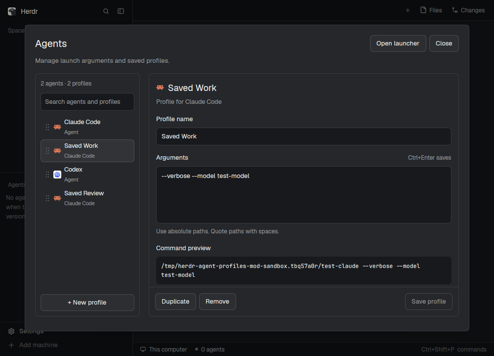
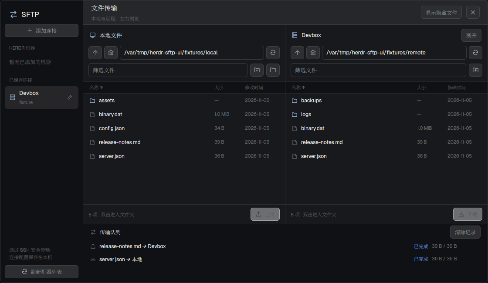
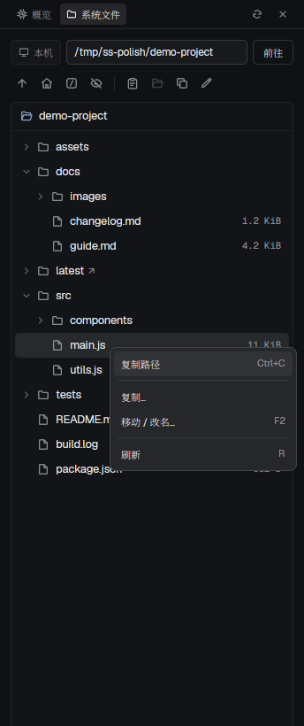

<div align="center">

  <h1>Coffre · Herdr Mods</h1>
  <p><strong>Three standalone native <a href="https://herdr.dev/">Herdr</a> mods</strong><br />Built with <code>gpui-kit</code> / <code>gpui-base</code> / <code>herdr</code> APIs</p>
  <p>
    <a href="https://herdr.dev/"></a>
    <a href="https://gpui-kit.com/"></a>
    = 22.15" />
    
    <a href="LICENSE"></a>
  </p>
  <p>
    <a href="README.md">简体中文</a> ·
    <a href="README.md">English</a> 
  </p>
  <p>
    <a href="#overview">Overview</a> ·
    <a href="#interface-previews">Previews</a> ·
    <a href="#installation">Installation</a> ·
    <a href="#permissions--data-scope">Permissions</a> ·
    <a href="#development--testing">Testing</a> ·
    <a href="#acknowledgments">Acknowledgments</a>
  </p>

</div>

---

## Overview

A curated collection of three independently installable native Herdr mods. Every bundle ships with documentation, a rebuild **RECIPE**, real native UI screenshots, and automated tests.

| Mod | Capabilities | Documentation |
| --- | --- | --- |
| **Agent profiles** | Manage agent launch arguments, save named profiles, drag-to-reorder & quick-launch popup | [README](agent-profiles/README.md) · [RECIPE](agent-profiles/RECIPE.md) |
| **SFTP** | SSH connections, dual-pane local/remote browser, upload/download & serial transfer queue | [README](sftp/README.md) · [RECIPE](sftp/RECIPE.md) |
| **System status** | Live machine metrics, per-machine persisted file tree, drag-and-drop move & context menu | [README](system-status/README.md) · [RECIPE](system-status/RECIPE.md) |

> [!TIP]
> The **System status** file tree switches automatically with the active `machine`, while preserving your browsing position across terminals, sessions, or spaces on the same machine. Copy/move actions execute within that machine; use the **SFTP** mod for local ↔ remote transfers.

## Interface Previews

<table>
  <tr>
    <td align="center" width="33%">
      <a href="agent-profiles/README.md"><strong>Agent profiles</strong></a><br />
      <br />
      <sub>Launch args · Named profiles · Drag ordering</sub>
    </td>
    <td align="center" width="33%">
      <a href="sftp/README.md"><strong>SFTP</strong></a><br />
      <br />
      <sub>SSH browser · Dual-pane · Serial queue</sub>
    </td>
    <td align="center" width="33%">
      <a href="system-status/README.md"><strong>System status</strong></a><br />
      <br />
      <sub>Live telemetry · Per-machine file tree</sub>
    </td>
  </tr>
</table>

## Requirements

- **Herdr CLI & App** (`herdr-app`, `hc`)
- **Node.js 22.15+** & **Bash** (zero external npm dependencies)
- **Python 3 + Paramiko** (required by SFTP)
- **OpenSSH `sftp-server`** (for SFTP real-protocol integration tests; skipped if absent)

## Installation

> [!IMPORTANT]
> Read the target package's `README.md`, `RECIPE.md`, and source first. Copy **only** `mods/<name>/` into `${HERDR_APP_HOME:-$HOME/.config/herdr-app}/mods/`—do not copy docs, screenshots, or test suites into app home. Never overwrite an existing mod, and avoid symlinks across app home boundaries.

```bash
git clone https://github.com/Right202209/coffre.git
cd coffre
```

### Agent profiles (standard copy flow)

```bash
(
  set -e
  app_dir=${HERDR_APP_HOME:-"$HOME/.config/herdr-app"}
  target="$app_dir/mods/agent-profiles"
  if [ -e "$target" ] || [ -L "$target" ]; then
    echo "Existing mod found; rename and update internal references: $target" >&2
    exit 1
  fi
  mkdir -p "$app_dir/mods"
  cp -R agent-profiles/mods/agent-profiles "$target"
  herdr-app check "$target"
)
herdr-app do mod.open --name agent-profiles
```

### SFTP (with isolated Python `.venv`)

```bash
cd sftp
./install.sh
herdr-app do mod.open --name sftp
```

Optional: add a 28px launcher button above Settings in your personal layout (run `layout.clone` first if using an official layout):

```bash
python3 install-launcher.py
```

### System status (recommended as a personal layout block)

```bash
(
  set -e
  app_dir=${HERDR_APP_HOME:-"$HOME/.config/herdr-app"}
  target="$app_dir/mods/system-status"
  if [ -e "$target" ] || [ -L "$target" ]; then
    echo "Existing mod found; rename and update internal paths: $target" >&2
    exit 1
  fi
  mkdir -p "$app_dir/mods"
  cp -R system-status/mods/system-status "$target"
  herdr-app check "$target"
)
```

Clone an official layout if needed (`herdr-app do layout.clone '{"name":"main","as":"my-layout"}'`), then add the block to a row with `language: "en"` if desired:

```json
{
  "id": "system-status-panel",
  "type": "block",
  "size": { "px": 344 },
  "min": 220,
  "content": {
    "mod": "system-status",
    "props": { "node": "system-status-panel", "language": "en" }
  }
}
```

## Permissions & Data Scope

All three mods install with `place: none`:

| Mod | External Execution | Network / Remote | Local Storage & State |
| --- | --- | --- | --- |
| **Agent profiles** | Launches selected agents via Herdr commands | None | Reads/writes `programs.json`, `agent-launch-profiles.json` & shared state |
| **SFTP** | Runs `hc`, Python 3, OpenSSH (`ssh`) | Connects to user-specified SSH/SFTP hosts | Reads `~/.ssh/config` & selected dirs; stores job records in `data/sftp/` |
| **System status** | Runs `hc exec` for metrics, listing & `cp` / `mv` | Uses registered Herdr machine connections | Writes SVG chart cache to `data/system-status/`; stores last path in shared state |

## Repository Structure

<details>
<summary>Expand directory tree</summary>

```text
coffre/ (herdr-mods)
├── agent-profiles/
│   ├── README.md                # Usage & cross-mod integration
│   ├── RECIPE.md                # Rebuild specification
│   ├── preview.png              # Native screenshot
│   └── mods/agent-profiles/     # Runtime code, SVG icons & tests
├── sftp/
│   ├── README.md
│   ├── RECIPE.md
│   ├── preview.png
│   ├── mods/sftp/               # GPUI panel, model & Python backend
│   ├── tests/                   # JS & Python/OpenSSH protocol tests
│   ├── requirements.txt
│   ├── install.sh               # Automated mod + .venv installer
│   └── install-launcher.py      # Optional personal layout launcher entry
├── system-status/
│   ├── README.md
│   ├── RECIPE.md
│   ├── preview.png
│   └── mods/system-status/      # Runtime code, icons, typings & tests
├── scripts/                     # Repo checks (check.sh) & Python test runner
├── CONTRIBUTING.md
└── package.json
```

</details>

## Development & Testing

```bash
# Prepare SFTP Python test dependencies (or use uv venv / uv pip install)
python3 -m venv sftp/.venv
sftp/.venv/bin/python -m pip install -r sftp/requirements.txt

npm test           # JS tests for all 3 mods + SFTP Python tests
npm run check      # Bundle structure checks + herdr-app check for each mod
```

Run suites individually with `npm run test:js` or `npm run test:python` (override Python via `HERDR_MODS_PYTHON=/abs/path/to/python npm run test:python`). Note that `herdr-app check` only verifies initial load and immediate render; always verify async data and interactive flows inside Herdr. See [CONTRIBUTING.md](CONTRIBUTING.md) for conventions.

## Acknowledgments

- **[Herdr](https://herdr.dev/)** — Native mod runtime, terminal/machine orchestration, and bundled API docs
- **[gpui-kit](https://gpui-kit.com/)** — Native GPUI JavaScript UI components and layout primitives
- **[Netcatty](https://github.com/binaricat/Netcatty)** — Especially its [SFTP view](https://github.com/binaricat/Netcatty/tree/main/components/sftp), which inspired the SFTP mod's dual-pane workflow

## License

MIT
