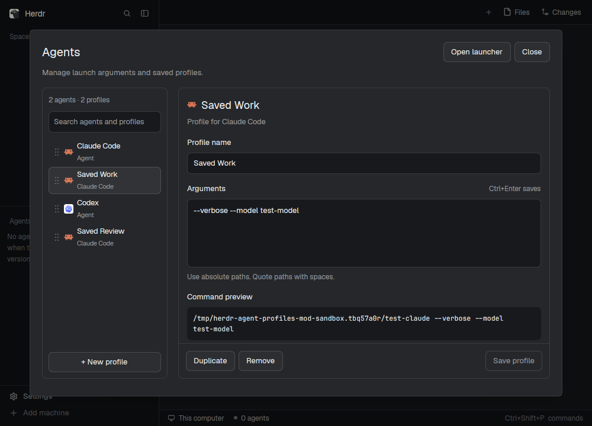
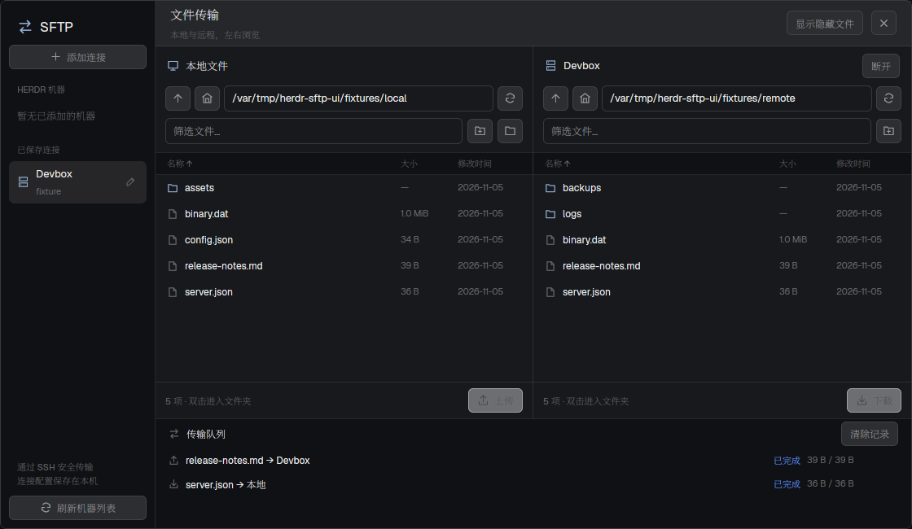
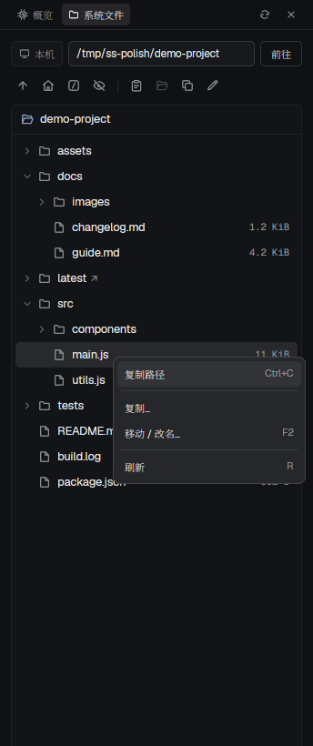

<div align="center">

  <h1>Coffre · Herdr Mods</h1>
  <p><strong>三个可独立安装的原生 <a href="https://herdr.dev/">Herdr</a> Mod 集合</strong><br />基于 <code>gpui-kit</code> / <code>gpui-base</code> / <code>herdr</code> API 构建的纯原生桌面面板</p>
  <p>
    <a href="https://herdr.dev/"></a>
    <a href="https://gpui-kit.com/"></a>
    = 22.15" />
    
    <a href="LICENSE"></a>
  </p>
  <p>
    <a href="README.md">简体中文</a> ·
    <a href="README.en.md">English</a>
  </p>
  <p>
    <a href="#模块总览">模块总览</a> ·
    <a href="#界面预览">界面预览</a> ·
    <a href="#快速安装">快速安装</a> ·
    <a href="#权限与数据边界">权限与数据边界</a> ·
    <a href="#开发与验证">开发与验证</a> ·
    <a href="#参考与致谢">参考与致谢</a>
  </p>

</div>

---

## 模块总览

本仓库提供三个开箱即用、彼此独立的原生 Herdr Mod。每个模块均附带**使用文档**、**可从零复现的构建配方（RECIPE）**、**真实原生界面截图**与**自动化测试**。

| Mod | 核心能力 | 适用场景 | 文档与配方 |
| --- | --- | --- | --- |
| **Agent profiles** | 扫描已安装 Agent、管理启动参数与命名配置、拖拽排序及快捷启动浮窗 | 高频切换多种 CLI Agent 参数预设 | [使用说明](agent-profiles/README.md) · [构建配方](agent-profiles/RECIPE.md) |
| **SFTP** | 读取 Herdr 机器或自定义 SSH 配置、本地/远程双栏浏览、传输队列与进度取消 | 本机与远程服务器之间安全上传/下载文件 | [使用说明](sftp/README.md) · [构建配方](sftp/RECIPE.md) |
| **系统状态** | 实时系统资源指标（CPU/内存/磁盘/网络）与按 Machine 记忆位置的文件树（拖放/右键） | 侧栏实时监控与同机内文件快速管理 | [使用说明](system-status/README.md) · [构建配方](system-status/RECIPE.md) |

> [!TIP]
> **跨机传输 vs 同机操作**：**系统状态**的文件树会随当前 `machine` 自动切换（同一 `machine` 内切换终端、会话或 `space` 会保留浏览位置），其中的复制与移动均在**该机器内部**执行；若需在**本机与远程**之间上传或下载文件，请使用 **SFTP** mod。

## 界面预览

<table>
  <tr>
    <td align="center" width="33%">
      <a href="agent-profiles/README.md"><strong>Agent profiles</strong></a><br />
      <br />
      <sub>启动参数管理 · 命名配置 · 拖拽排序</sub>
    </td>
    <td align="center" width="33%">
      <a href="sftp/README.md"><strong>SFTP</strong></a><br />
      <br />
      <sub>SSH 连接 · 双栏浏览 · 串行传输队列</sub>
    </td>
    <td align="center" width="33%">
      <a href="system-status/README.md"><strong>系统状态</strong></a><br />
      <br />
      <sub>实时指标 · 按 Machine 记忆的文件树</sub>
    </td>
  </tr>
</table>

## 环境要求

| 组件 | 用途说明 | 最低要求 |
| --- | --- | --- |
| **Herdr CLI & App** | Mod 运行环境、`herdr-app check` 校验与 `hc` 命令 | 已安装 `herdr-app` 与 `hc` |
| **Node.js** | 运行三个 Mod 的 JavaScript 单元测试（零外部 npm 依赖） | `>= 22.15.0` |
| **Bash** | 执行安装与仓库级校验脚本 | Linux / macOS |
| **Python 3 + Paramiko** | 运行 SFTP 后端及 Python 单元测试 | 仅 **SFTP** 需要 |
| **OpenSSH `sftp-server`** | 运行 SFTP 真实协议集成测试（缺少时自动跳过） | 仅 **SFTP 协议测试** 需要 |

## 快速安装

> [!IMPORTANT]
> **安装前必读**：
> 1. 先阅读目标包的 `README.md`、`RECIPE.md` 与源码。
> 2. **仅复制** `<mod>/mods/<名称>/` 到 `${HERDR_APP_HOME:-$HOME/.config/herdr-app}/mods/`，无需将说明文档、截图或测试目录放进 app home。
> 3. **禁止直接覆盖已有 Mod**；如改名安装，需同步修改自打开的 `mod` 名称与 `mods/<名称>/` 图标资源路径。
> 4. 请使用真实目录复制而非跨 app home 符号链接（资源加载器可能会拒绝跨目录软链）。

首先克隆仓库到本地：

```bash
git clone https://github.com/Right202209/coffre.git
cd coffre
```

### 方式 A：安装 Agent profiles（通用复制流程示例）

```bash
(
  set -e
  app_dir=${HERDR_APP_HOME:-"$HOME/.config/herdr-app"}
  target="$app_dir/mods/agent-profiles"
  if [ -e "$target" ] || [ -L "$target" ]; then
    echo "已有同名 mod，请先使用新名称并调整包内引用：$target" >&2
    exit 1
  fi
  mkdir -p "$app_dir/mods"
  cp -R agent-profiles/mods/agent-profiles "$target"
  herdr-app check "$target"
)
herdr-app do mod.open --name agent-profiles
```

### 方式 B：安装 SFTP（含独立 Python 环境）

SFTP mod 提供了自动化安装脚本，会自动复制文件并在 mod 目录创建 `.venv` 安装 Paramiko：

```bash
cd sftp
./install.sh
herdr-app do mod.open --name sftp
```

如需在个人布局的 Settings 上方添加快捷入口（28px block，自动备份原布局；若使用官方布局请先执行 `layout.clone`）：

```bash
python3 install-launcher.py
```

### 方式 C：安装 系统状态（推荐加入个人布局）

1. 复制运行时目录并校验：

```bash
(
  set -e
  app_dir=${HERDR_APP_HOME:-"$HOME/.config/herdr-app"}
  target="$app_dir/mods/system-status"
  if [ -e "$target" ] || [ -L "$target" ]; then
    echo "已有同名 mod，请先改名并调整包内引用：$target" >&2
    exit 1
  fi
  mkdir -p "$app_dir/mods"
  cp -R system-status/mods/system-status "$target"
  herdr-app check "$target"
)
```

2. 若当前使用官方布局，先克隆为个人布局，再将面板 block 加入布局行（`props.node` 需与 `id` 一致）：

```bash
herdr-app do layout.clone '{"name":"main","as":"my-layout"}'
```

```json
{
  "id": "system-status-panel",
  "type": "block",
  "size": { "px": 344 },
  "min": 220,
  "content": {
    "mod": "system-status",
    "props": { "node": "system-status-panel", "language": "zh" }
  }
}
```

## 权限与数据边界

三个 Mod 均默认以 `place: none` 安装，在运行前可清晰了解各自的命令执行、网络与本地存储范围：

| Mod | 执行命令 / 外部进程 | 网络与远程访问 | 本地读写与持久化路径 |
| --- | --- | --- | --- |
| **Agent profiles** | 扫描已安装 Agent；通过 Herdr 命令启动所选 Agent 或终端 | 无外部网络连接 | 读写 app home 下的 `programs.json`、`agent-launch-profiles.json` 及 shared state（`personal-launcher.*`） |
| **SFTP** | 调用 `hc`、Python 3 与 OpenSSH（`ssh`） | 连接用户选择的 SSH/SFTP 服务器；不保存密码或私钥内容 | 读取 `~/.ssh/config` 与本地选定目录；连接配置存 `sftp.connections.v1`，任务记录写 `data/sftp/jobs/` |
| **系统状态** | 通过 `hc exec` 在目标机器执行只读指标采集及用户触发的 `cp` / `mv` | 仅通过 Herdr 已注册的 `machine` 通道通信 | 动态 SVG 图标缓存写入 `data/system-status/`；每台机器最近目录与隐藏文件开关存 shared state |

## 目录结构

每个 Mod 包内均包含独立的运行目录 `mods/<名称>/`、说明文档 `README.md`、构建配方 `RECIPE.md` 与原生截图 `preview.png`。

<details>
<summary>点击展开完整仓库目录树</summary>

```text
coffre/ (herdr-mods)
├── agent-profiles/
│   ├── README.md                # 使用说明与外部调用方式
│   ├── RECIPE.md                # 从零重建配方
│   ├── preview.png              # 原生界面截图
│   └── mods/agent-profiles/     # 运行代码、SVG 图标与测试
├── sftp/
│   ├── README.md                # 连接、传输行为与限制说明
│   ├── RECIPE.md
│   ├── preview.png
│   ├── mods/sftp/               # GPUI 面板、模型与 Python 后端
│   ├── tests/                   # JS 与 Python/OpenSSH 协议测试
│   ├── requirements.txt
│   ├── install.sh               # 一键安装 mod 与 .venv 依赖
│   └── install-launcher.py      # 可选：插入个人布局入口
├── system-status/
│   ├── README.md                # 配置项、快捷键与行为矩阵
│   ├── RECIPE.md
│   ├── preview.png
│   └── mods/system-status/      # 运行代码、图标、手写类型与测试
├── scripts/                     # 仓库级检查 (check.sh) 与 Python 测试入口
├── CONTRIBUTING.md              # 开发规范与 Herdr 运行约束
└── package.json
```

</details>

## 开发与验证

仓库内置零第三方 npm 依赖的 Node 原生测试与 Python 协议测试，修改任意 Mod 后请先在根目录执行验证：

```bash
# 1. 一次性准备 SFTP Python 测试环境（亦可使用 uv venv / uv pip install）
python3 -m venv sftp/.venv
sftp/.venv/bin/python -m pip install -r sftp/requirements.txt

# 2. 运行全部测试与检查
npm test           # 运行三个 Mod 的 JS 测试 + SFTP Python 测试
npm run check      # 检查发布包必需文件 + 对每个 Mod 执行 herdr-app check
```

常用细分命令：

- `npm run test:js` — 仅运行三个 Mod 的 JavaScript 单元测试
- `npm run test:python` — 仅运行 SFTP Python 测试（可通过 `HERDR_MODS_PYTHON=/abs/path/to/python npm run test:python` 指定已有 Python 环境）

> [!NOTE]
> `herdr-app check` 仅校验首次加载与即时渲染，无法替代应用内的异步数据加载、延迟列表及键鼠交互验证。开发时请以当前 app home 中自动生成的 `AGENTS.md`、`gpui-kit.d.ts` 和 `herdr.d.ts` 为 API 基准（请勿将这些生成文件纳入 Git；手写 `types.d.ts` 保留）。更多规范见 [CONTRIBUTING.md](CONTRIBUTING.md)。

## 参考与致谢

感谢以下项目的作者与维护者提供的运行时、UI 基础设施与交互灵感：

- **[Herdr](https://herdr.dev/)** — 提供原生 Mod 运行环境、终端与 Machine 管理及随附 API 文档
- **[gpui-kit](https://gpui-kit.com/)** — 提供基于 GPUI 的声明式 JavaScript 界面组件与布局能力
- **[Netcatty](https://github.com/binaricat/Netcatty)** — 其 [SFTP 页面](https://github.com/binaricat/Netcatty/tree/main/components/sftp) 为本仓库 SFTP Mod 的双栏文件浏览与传输队列交互提供了重要参考（详见 [SFTP 说明](sftp/README.md)）

## License

[MIT](LICENSE)
