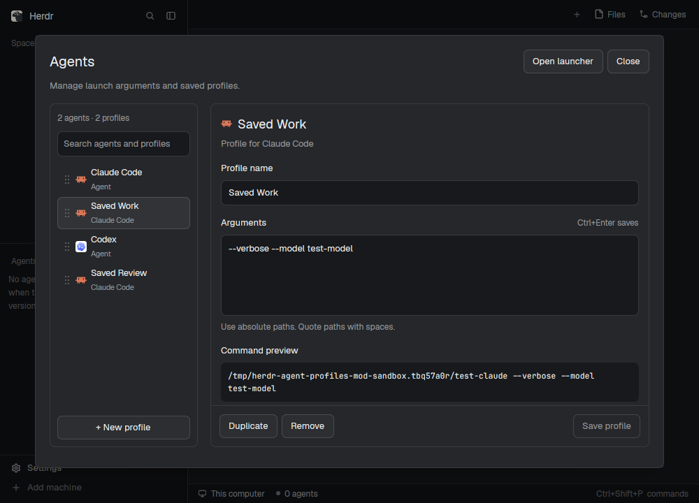

# Agent profiles

A standalone Herdr mod for finding available agents, saving launch profiles,
and dragging them into the order used by the launcher.



## Install

Review `RECIPE.md` and `mods/agent-profiles/`. Copy the `agent-profiles` mod folder
into your Herdr app home's `mods/` directory. The usual destination is
`~/.config/herdr-app/mods/agent-profiles`; `HERDR_APP_HOME` selects another home.

Use an unused mod name. If `agent-profiles` already exists, rename this copy and
update its self-opening `mod` names and `mods/agent-profiles/` asset paths.

Then check and open it:

```sh
herdr-app check "${HERDR_APP_HOME:-$HOME/.config/herdr-app}/mods/agent-profiles"
herdr-app do mod.open --name agent-profiles
```

The bundle contains the mod, tests, recipe, and preview. Existing launch
configuration is read from the destination's app home.

## Use

Search available agents and saved profiles in the left list. An agent row edits
its default launch arguments. Named profiles have their own complete arguments.
New profile and Duplicate create drafts; Save commits them. Remove confirms an
existing profile's deletion; Discard removes a new draft immediately.

Drafts survive switching rows and changing the search. A dot marks unsaved
changes. Saved profiles for unavailable agents remain editable. Arguments allow
multiple lines, quotes, and escapes; Ctrl+Enter saves, or Cmd+Enter on macOS.
The command preview shows the resulting argv. Use absolute paths for files on
the machine running the agent.

Drag a row or its grip to order agents and profiles together. The order is
shared with the launcher and remembered separately for each machine. The
manager stacks its list above the editor on narrow windows.

**Open launcher** opens the popup while keeping the manager's drafts.
**Back to profiles** returns to that manager. Click an available agent or saved
profile to launch directly; Up/Down select, Enter launches, and 1–9 launch the
corresponding row. The popup also includes Terminal, New space, and Herdr's
worktree actions.

## Open from another mod

```js
import { openOverlay } from "herdr";

openOverlay({
  mod: "agent-profiles",
  kind: "popup",
  width: 440,
  height: 480,
  props: { view: "launcher" },
});
```

**Edit profiles** in that popup opens this mod's manager at the selected entry.
To open a specific profile directly, use a dialog with
`props: { view: "profiles", agent: "claude", profile: "work", machine: null }`.
`profile` is the saved stable id, and `machine: null` chooses this device.

## Saved data and compatibility

The mod reads and writes `programs.json` and `agent-launch-profiles.json` under
Herdr's app home. It saves order and selection through Herdr shared state using
`personal-launcher.order` and `personal-launcher.selection`. This preserves
compatibility with the existing personal Settings and launcher customization.

Launching uses Herdr's commands to run the configured agent or shell. Worktree
actions open Herdr's shipped worktree mod. Saves use atomic compare-and-write,
preserve unrelated metadata, and report changes to the same configuration.

Tested on Herdr 0.1.11. The mod uses `gpui-kit`, `gpui-base`, and `herdr`, with
all JavaScript helpers and custom SVG assets inside its own folder.

From the bundle root, with Node 22.15 or newer:

```sh
node --test --test-isolation=none mods/agent-profiles/tests/*.test.mjs
herdr-app check mods/agent-profiles
```
