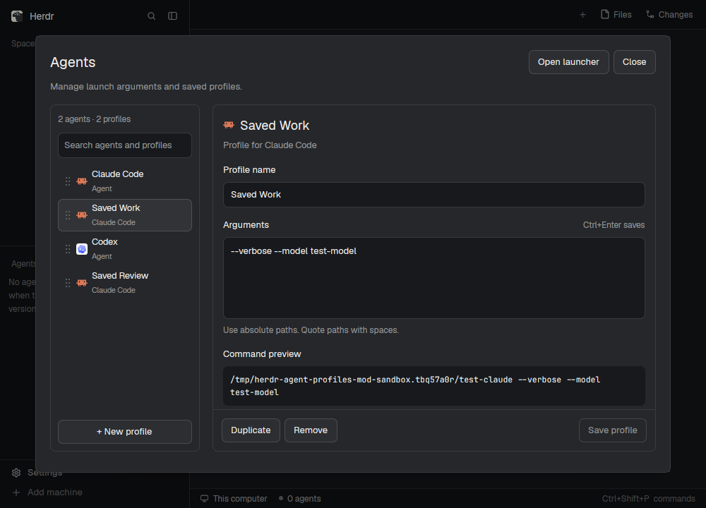

# Agent profiles

A native Herdr profile manager with a searchable agent/profile list beside an
argument editor, and a popup launcher that shares the list's saved order.

## What you see

The manager is a centered 900 × 620 logical-pixel dialog with 20 px inner
padding. Its top row has a 20 px semibold Agents title, Open launcher, and Close.
A muted sentence explains that it manages launch arguments and saved profiles.
Use the active Herdr theme's popover, background, raised, hover, border, input,
foreground, muted, dim, accent, and blocked colors.

Below, a 212 px list sits beside the editor with an 18 px gap. The list shows
agent/profile counts, a 36 px search input, scrolling 46 px rows, and New profile.
Rows have a drag grip, the agent's icon, name and type/agent caption, and a small
accent dot when edited. The selected row uses a raised surface and input border.

The editor shows a title and agent caption, a 36 px name input for named
profiles, and a 116 px multiline argument field. Help text, command preview in
11.5 px JetBrains Mono, and the resulting tab name follow. The form scrolls
independently above a footer with Duplicate, Remove/Discard, Save, and validation
or save status. Default agent rows use Save arguments; named rows use Save profile.

Below 560 px content width, stack a 240 px list above a 492 px editor with a
16 px gap. The manager's outer area scrolls so the footer remains reachable.

The launcher is a 440 px popup, up to 460 px of rendered content. It contains
Terminal, a Start an agent heading with Edit profiles or Back to profiles,
scrolling 34 px agent/profile rows, and New space/worktree actions. Rows show
their icons and 1–9 shortcuts. Selecting a row launches it directly.

## How it behaves

Search matches agent and profile names case-insensitively with all typed terms.
Keep a matching saved name during an unsaved rename. Preserve drafts and dirty
markers when switching rows or searching. Available agent rows represent their
default arguments. Saved profiles for unavailable agents remain editable in the
manager; the launcher contains only configurations whose agent is available.

New profile starts with default arguments. Duplicate copies the selected draft's
arguments. Save validates names and parses arguments; Enter inserts a newline,
and Ctrl+Enter/Cmd+Enter saves. Named profiles have complete, independent argument
lists. Confirm before removing a saved profile; discard an unsaved profile directly.

Drag rows or grips to reorder. The upper/lower half of the target means
before/after. Show an accent insertion line and dim the source. Escape, leaving
the list, or a removed source/target cancels. Drops never save argument drafts or
start terminals. Persist order per machine, preserve unavailable entries' slots,
and append new entries.

Open launcher keeps the manager open underneath. Back to profiles closes that
popup and preserves the manager's draft. A separately opened popup's Edit
profiles opens a manager at the selected agent/profile and captured machine.
Up/Down select popup rows; Enter and 1–9 launch once. Re-read configuration and
availability before launch. A changed argv or name requires another selection;
deleted profiles, unavailable agents, and closed captured spaces cannot launch.

Rows describe launch configurations. Herdr supplies working, blocked, done, and
idle terminal indicators after an agent launches.

## Built from

One folder, `mods/agent-profiles/`, with `main.js`, `mod.json`, `launcher.js`,
`agent-settings.js`, `launch-config.js`, `profiles.js`, `order.js`, `grip.svg`,
`branch.svg`, README, and Node tests. The default export in `main.js` extends the
launcher and chooses profiles by default or launcher from `props().view`.
The manager uses `AgentSettings` and supplies the header's action controls.

Use `gpui-kit` elements, `gpui-base` flex and input/textarea state, focus handles,
and fresh callback contexts. Use native size-change and pointer callbacks for
responsive layout and dragging. Root profiles mode is 620 px high with an outer
scroll area; the profile form has its own scroll area and footer.

Herdr APIs: theme, props, spaces, panes, knownAgents, keys, window, appHome,
readTextFile, writeTextFile, shared, setShared, run, openOverlay, and closeOverlay.
Commands: tab.new and space.new. Worktree actions open the shipped worktree mod
with captured space, folder, and action. Agent icons come from knownAgents;
shell.svg is shipped by Herdr, and grip/branch assets belong to this mod.

Store named configurations in app-home `agent-launch-profiles.json`, version 1,
with per-agent profiles of stable id, name, and argv-style args. Default arguments
update only `programs.<agent>.run` in `programs.json`. Shared order uses
`personal-launcher.order`, keyed by machine (`""` locally), with identities made
by `JSON.stringify([agentKey, profileId])`. Last-launched selection uses
`personal-launcher.selection`. These names keep existing personal data compatible.

Popup entry: `openOverlay({ mod: "agent-profiles", kind: "popup", width: 440,
height: 480, props: { view: "launcher" } })`. Manager entry uses a dialog and
`props: { view: "profiles", agent, profile, machine }`; null machine is local.
`returnToManager` is an internal flag for popups opened above their own manager.

## Watch out

Keep helper imports local to this folder. When renaming the mod, update its
self-opening names and SVG paths. Use Herdr 0.1.11's installed APIs as the baseline.
Shipped layouts and Settings are owned by Herdr; integration goes in personal mods.

Default is a reserved profile id and name. Names are unique per agent and at
most 64 characters. Parse quotes and escapes without evaluating shell syntax,
variables, globs, or tilde. Paths belong to the launching machine.

Save with atomic compare-and-write. Retry unrelated concurrent edits and preserve
metadata; report same-profile/default-command conflicts. Invalid or unsupported
configuration blocks usage and is never replaced. Preserve newer edits made
while a save/removal is pending, and revalidate sibling names when renaming.

The launcher captures its space and machine when it opens. Availability checks
and persisted order follow that machine. Do not accidentally launch from a drag
or launch twice from click/mouse-up callback ordering.

## Done when

The mod passes `herdr-app check`; its Node tests pass independently from this
folder. On an isolated native display, loading needs only this mod and Herdr's
shipped dependencies. Search selects a profile, dragging updates popup order
without writes or launches, a draft survives opening/returning from the popup,
multiline arguments save and reopen correctly, a saved row launches once, and
the narrow layout's editor footer is reachable. Capture preview.png from that
isolated window.
