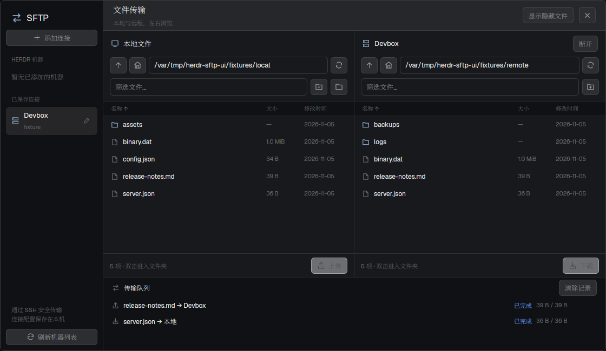

# Herdr SFTP

原生 GPUI 文件传输面板，参考 [Netcatty 的 SFTP 页面](https://github.com/binaricat/Netcatty/tree/main/components/sftp)，像 Settings 一样以弹窗打开。



左侧选择 Herdr 已添加的机器或自行保存的 SSH 连接，右侧双栏浏览本地与远程目录，下方显示传输队列。支持路径跳转、文件名筛选、隐藏文件、排序、新建文件夹、多文件上传下载、进度和取消。目录行双击进入，文件行单击切换选中。

## 安装与打开

需要 Linux/macOS、Python 3、OpenSSH，以及 `uv` 或 Python 的 `venv` / `pip`。已在 Linux 验证。远程服务器只需提供 SFTP，无需安装 Herdr。Node 仅用于开发测试。

```sh
cd sftp
./install.sh
herdr-app do mod.open --name sftp
```

以上命令从仓库根目录开始；后续安装入口和开发命令均在本包目录 `sftp/` 运行。

安装器将 mod 复制到 `${HERDR_APP_HOME:-~/.config/herdr-app}/mods/sftp`，在该目录的 `.venv` 中安装 Paramiko，并运行 `herdr-app check`。再次运行可更新本 mod；拒绝覆盖其他来源的同名 mod。

在当前个人布局的 Settings 上方添加入口：

```sh
python3 install-launcher.py
```

入口安装器只在有 `sidebar-footer` 的个人布局插入一个 28px 的 `sftp` block，保留原文件备份。官方布局须先用 `layout.clone` 复制。没有入口时仍可通过命令打开。

## 连接

- **已有机器**：读取 `hc machine ls --json`，使用机器的 SSH `target`，过滤临时机器。Herdr core 离线也可以尝试独立的 SFTP 连接。
- **自己添加**：填写 SSH 别名或 `user@host`，可设置用户名、端口、私钥路径和起始目录。留空的端口/用户尊重 `~/.ssh/config`，支持 ProxyJump 和 SSH Agent。
- **密码、加密私钥或首次主机确认**：连接失败后点击「SSH 认证」，在原生终端回答 OpenSSH 提示，关闭认证窗口后重新连接。认证复用 10 分钟，不保存密码或私钥内容，不自动信任未知/变更的主机密钥。
- **保存位置**：连接参数在 Herdr shared state 的 `sftp.connections.v1`；连接名称旁的编辑按钮可修改或移除记录。不会向 Herdr 注册新机器。

## 传输行为

选择左侧文件点「上传」，或右侧文件点「下载」，目标为另一栏当前目录。每个任务固定提交时的机器和两端路径，随后切换机器或目录不会改变任务目标。任务串行执行；「断开」只结束浏览，队列仍可继续。

普通文件通过 SFTP 传输，临时文件完成后才发布，已有同名目标会报错。支持取消，关闭面板会取消未完成的传输；如果应用异常退出，后台任务在失去 45 秒心跳后停止。服务器失联时临时文件可能无法清理，错误会给出路径。

当前不支持递归传输文件夹、传输符号链接、覆盖文件、断点续传、远程编辑或删除。可以进入文件夹后多选普通文件。单个目录最多 10,000 项；单次浏览操作限时 24 秒，单文件传输最多一小时。

这个 mod 会运行 `hc`、Python 和 `ssh`，读取用户选择的本地/远程目录及 SSH 配置，向所选服务器发起连接，并按用户操作读写文件。任务状态保存在 `data/sftp/jobs/`，完成记录不包含文件内容。

## 开发与验证

```sh
uv venv .venv
uv pip install --python .venv/bin/python -r requirements.txt
npm test
.venv/bin/python -m unittest discover -s tests -p 'test_*.py' -v
herdr-app check mods/sftp
```

Python 测试使用本机 OpenSSH `sftp-server` 跑真实 SFTP 协议，覆盖 Unicode/特殊文件名、链接目录、二进制往返、同名冲突、目标竞争创建、取消清理及心跳过期。没有该程序时这些协议测试会明确跳过。

原实现的验证记录：11 项 Python 测试、5 项 JavaScript 测试通过；独立 Xvfb 窗口中完成添加连接、双栏浏览、上传、下载及关闭面板取消正在运行的传输，也验证过真实 SSH 服务器上的后台任务往返和取消。预览来自独立测试服务器；整理仓库时沿用该预览，未重新连接个人服务器。

实现分为 `main.js`（原生面板和任务控制）、`model.js`（连接/路径/排序/传输快照）、`backend.py`（OpenSSH 连接、SFTP 文件操作和后台任务）。`props.connection` 与 `props.localPath` 可用于从另一个 mod 打开指定位置；`props.launcher: true` 只渲染入口。

移除时关闭面板，删除布局中 id 为 `sftp-launcher` 的 block，再删除 `mods/sftp`。连接参数和任务记录按需从 shared state / `data/sftp` 清理。
