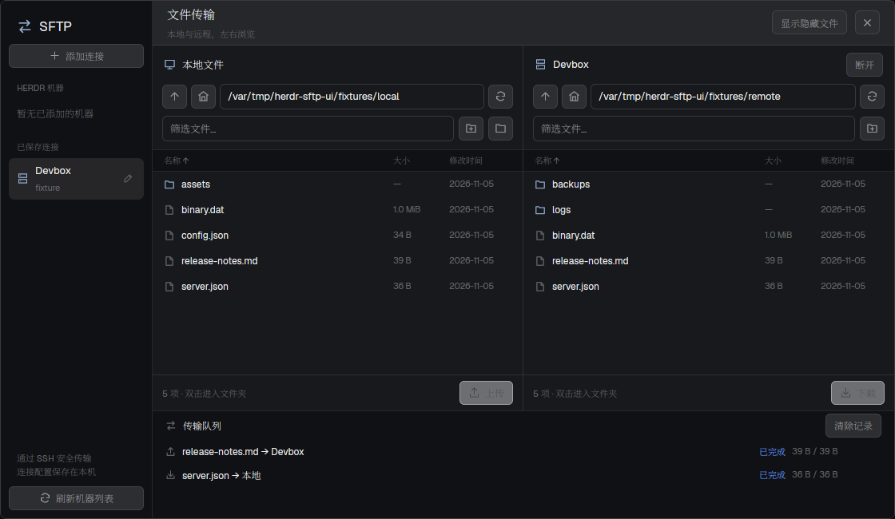

# SFTP

一个像 Settings 一样打开的原生文件传输面板。左侧选择已有机器或添加连接，中间并排浏览本地和远程文件，下方查看任务进度。参考 Netcatty 的双栏 SFTP 浏览方式，沿用 Herdr 当前主题。

## What you see

弹窗 1120 × 650 逻辑像素。左侧 190px（窄窗口 164px）连接栏，顶部 SFTP 标识和「添加连接」，下方分「HERDR 机器」「已保存连接」。底部有刷新机器列表。

右侧顶栏 56px，包含「文件传输」、隐藏文件开关和关闭按钮。内容两栏等宽；每栏有标题、路径输入、上一级/主目录/刷新、新建文件夹、文件名筛选。列表行 32px，列为名称、大小，足够宽时显示修改日期。目录使用主题 accent 色文件夹图标，选中行使用 selected 背景。

添加连接表单显示在远程一栏：名称、主机、用户、端口、密钥路径、起始目录；保存和取消按钮固定在底部，内容可滚动。下方传输队列空闲 46px，有任务时 135px，可滚动。所有颜色来自 `theme()`，图标为 mod 自带的单色 SVG。

## How it behaves

点机器后读取目录，双击目录进入；单击文件行切换选中，可多选。路径回车跳转；筛选忽略大小写，隐藏文件默认不显示。按列标题切换正反排序，目录始终在前。上传或下载使用另一栏当前目录；队列保留提交时的机器/路径。切换目录/主机后返回的旧请求不会覆盖新状态。

已有目标拒绝覆盖。传输使用临时文件，完成后发布；状态有等待、连接、传输、完成、失败、取消。进度根据真实字节数刷新，每 600ms 读取一次正在运行任务的状态。没有传输时不轮询。关闭面板取消后台任务；异常退出后 45 秒心跳超时取消。断开浏览不会改动已排队的目标。

连接错误提供「SSH 认证」及「重新连接」。SSH 提示在原生终端中处理，密码不进入 mod 存储。Escape 先关闭新建文件夹或连接表单，再关闭弹窗。Enter 打开选中的目录。此 mod 不呈现 coding agent 状态。

## Built from

只有 `mods/sftp`。默认 `place: none`，`mod.open {name: "sftp"}` 打开。布局入口可用一个 28px block，content 为 `{mod: "sftp", props: {launcher: true}}`，放在 sidebar-footer 前。

使用 gpui-kit 的 View/div/svg 和 gpui-base 的 InputState/Input、虚拟列表、Scrollbar。使用 herdr 的 theme、hc、exec、shared/setShared、props、home/appHome、nextCommand、pickFolder、openOverlay/closeOverlay、run。不依赖 DOM、Node 或外部网站。

`hc machine ls --json` 提供机器 target。Python + Paramiko 通过系统 `ssh -s … sftp` 管道执行真实 SFTP；系统 SSH 保留配置、ProxyJump 和 Agent。后台传输进程绕过 Herdr 单次 exec 的 30 秒上限，JSON 状态文件和取消标记保存在 app home 的 data/sftp/jobs。凭证提示使用 `hc run --bg --json --no-parent` 创建认证终端，在 dialog 中展示。

## Watch out

不要改官方 mods、frame 或类型文件。虚拟列表的延迟渲染中不能注册事件或创建 InputState：事件绑定在列表的 on_item_click 上。每个异步回调使用自己的 cx。载入目录要使用 epoch 丢弃旧请求；传输须固定连接和路径。

Paramiko 的 listdir_iter 会流水线发送 READDIR，必须先完整消费返回，再做符号链接的 stat，不能交错。后台客户端使用 OpenSSH 严格校验主机密钥，不使用 accept-new/no。所有用户值通过 argv/JSON 传递，不拼 shell 命令。文件名保留 Unicode、空格、引号及换行；拒绝服务器返回的路径分隔符。

仅普通文件传输，无递归目录、符号链接传输、覆盖或续传；目录上限 10,000 项，浏览 24 秒，单文件传输一小时。已验证 Linux，未验证 macOS。临时文件清理失败时必须显示路径。Mod 热重载会结束当前 UI，后台依赖心跳退出。资产应复制进 app home；跨 app home 的目录符号链接会被资源加载器拒绝。

## Done when

1. `herdr-app check mods/sftp` 通过，真实窗口和 deferred list rows 均无错误。
2. 已有机器使用 target 成功读取目录，临时机器不显示；新连接可保存、编辑、移除。
3. 本地/远程路径、筛选、隐藏、排序和新建目录有效；表单保存按钮始终可见。
4. 真实 SFTP 二进制上传下载后字节一致；同名目标和传输中竞争创建的目标均保留原内容。
5. 取消/关闭不会发布未完成文件，后台状态能回报完成、失败和取消。
6. 连接失败显示错误，可重试或使用原生 SSH 认证。
