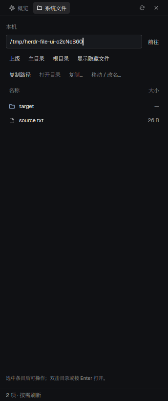

# 系统状态

“概览”显示当前 space 所在机器的系统指标；旁边的“系统文件”独立浏览本机文件系统。



预览采用已有隔离 Herdr 窗口截图，裁剪为系统文件面板。

## 安装与打开

需要 Herdr app、herdr-core，以及 Linux 或 macOS 的系统命令。先阅读 [RECIPE.md](RECIPE.md) 和 `mods/system-status/` 源码。该 mod 通过 `hc exec` 在所选机器运行只读系统采集命令；系统文件标签在本机读取目录，按用户操作运行 `cp` / `mv`；动态 SVG 缓存写入 app home 的 `data/system-status/`。

从仓库根目录运行（Bash）：

```bash
(
  set -e
  app_dir=${HERDR_APP_HOME:-"$HOME/.config/herdr-app"}
  target="$app_dir/mods/system-status"
  if [ -e "$target" ] || [ -L "$target" ]; then
    echo "已有同名 mod，请先改名并调整包内引用：$target" >&2
    exit 1
  fi
  mkdir -p "$app_dir/mods"
  cp -R system-status/mods/system-status "$target"
  herdr-app check "$target"
)
```

`mod.json` 使用 `place: none`，安装后不会自动停靠。若正在使用官方布局，先复制：

```sh
herdr-app do layout.clone '{"name":"main","as":"my-layout"}'
```

在个人布局的 row 中加入下面的 block；`props.node` 必须对应本 block 的 id，用于判断可见性和隐藏面板。已有个人布局可直接使用，不必再次复制。

```json
{
  "id": "system-status-panel",
  "type": "block",
  "size": { "px": 344 },
  "min": 220,
  "content": {
    "mod": "system-status",
    "props": { "node": "system-status-panel", "language": "zh" }
  }
}
```

也可由另一个 mod 以 overlay 打开，显式传入 `props: {visible: true}`。普通 `mod.open` 没有可见性参数，适合先查看界面；要采集概览数据，请采用上面的布局或 overlay 集成。

## 概览

- 显示 CPU、内存、磁盘、网络四组卡片、使用率环和最近 24 次采样趋势，以及负载、运行时间、系统、内核、交换空间和采集耗时。
- 跟随当前 space 的机器；可通过 `props.space` 固定到一个 space。没有 space 时显示无会话状态；无法连接或不支持的平台显示相应提示。
- 默认每约 5 秒采集一次，可通过 `props.intervalMs` 调整到 5000–60000 毫秒。多副本共享采集结果，面板隐藏、暂停或切到文件标签时停止请求新的概览采样。
- 支持刷新、暂停和恢复；有 `props.node` 时可隐藏面板。中文为默认语言，`props.language: "en"` 切为英文。默认减少动画，`props.reducedMotion: false` 启用资源条过渡。

## 系统文件

- 首次打开主目录，记住最近成功打开的目录、隐藏文件设置和当前标签。
- 切换终端、会话或 space 时，浏览目录、选中项和未提交的操作表单保持不变；文件操作始终在本机执行。
- 输入目录路径后按 Enter 或点击“前往”。支持绝对路径、`~` 和相对当前目录的路径；也可用主目录、根目录、上级按钮导航。
- 双击目录或选中后按 Enter 打开；方向键选择条目，Backspace 返回上级。
- “复制路径”复制选中条目的完整路径；未选中时复制当前目录路径。
- “复制…”执行 `cp`，“移动 / 改名…”执行 `mv`。填写目标路径后确认：已有目录接收条目，新路径指定新名称。已有同名目标会报错，不覆盖。
- 支持普通文件、目录和符号链接；目录复制包含隐藏文件，保留符号链接。
- 目录按需读取，用右上角刷新按钮更新；操作完成后自动刷新。每个目录最多显示 1000 项。

文件命令支持 Linux 和 macOS，遵循当前用户权限。命令超过 30 秒会提示检查是否已部分完成。

## 验证

从本包根目录 `system-status/` 运行（Node.js 22.15+）：

```sh
node --test mods/system-status/tests/*.test.mjs
herdr-app check mods/system-status
```

`herdr-app check` 不覆盖输入和异步加载后的交互；还需在 app 内验证路径输入、复制路径、复制、移动、目录导航，以及切换 space 后表单保持不变。

卸载时先删除个人布局中对应的 block，再移除 app home 的 `mods/system-status/`。不要删除仓库里的源码包来代替卸载。
