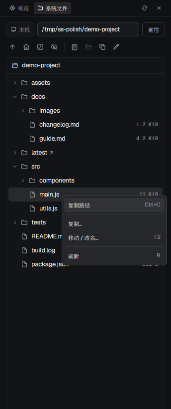

# 系统状态

一个原生 Herdr 侧栏，顶部在“概览”和“系统文件”之间切换。概览显示当前 space 所在机器的资源情况；系统文件跟随 machine 浏览文件树，为每台机器保留位置，支持右键菜单、复制路径、复制以及拖放移动文件和文件夹。

## What you see

推荐面板宽 344 逻辑像素。顶部 33px 标签栏包含两个标签、刷新按钮，以及概览的暂停按钮；绑定布局节点时显示关闭按钮。底部 27px 状态栏，中间区域可以滚动。整体使用当前 `theme()` 的 chrome、foreground、muted、selected、border 和 input 色，正文 11px，指标数字使用 Geist Mono。

概览先显示机器名，然后是 CPU、内存、磁盘、网络四张卡片，两列排列；窄于 260px 时改为单列。每张卡片包含图标、17px 主指标、详情、64px 使用率环和 34px 趋势图。继续向下显示负载、运行时间、系统、内核、交换空间和采集耗时，以及每核负载、磁盘、网络接口和进程内存。各明细最多显示 12 个核心、12 个磁盘、5 个网卡、5 个进程。资源条超过 60% 为黄色，超过 85% 使用主题 blocked 色。

系统文件第一行是带电脑／服务器图标的 machine 标签（“本机”或远程名称）、路径输入与“前往”。第二行是一排 26px 图标按钮，悬停显示名称：上级、主目录、根目录、隐藏文件切换（开启时为睁眼图标并带选中底色），分隔线后是复制路径、打开目录、复制、移动/改名；面板窄于 260px 时缩为 24px 以保持单行。文件树放在与概览卡片相同的圆角卡片中（6px 圆角、0.5px 淡化边框、淡化 selected 底色）。卡片顶部 32px 标题行显示当前目录名和 accent 色打开文件夹图标，也是拖放目标；下方为 28px 行，上下留 4px。每行依次为 16px 槽内的 12px SVG 箭头、14px muted 文件／文件夹图标、12.5px 名称（符号链接后附 ↗）及右对齐的 Geist Mono 大小；面板不窄于 460px 时再显示 UTC 修改时间。文件夹不显示大小。子目录每层缩进 16px；只绘制视口中的行，长树支持滚轮和 4px 宽的拖动滚动条。选中行使用主题选中色和 5px 圆角，列表有焦点时加 input 色描边；有效拖放目标使用 accent 描边和淡 accent 底色。右键菜单在面板内靠近指针打开，宽约 212px、8px 圆角，按组分隔，右侧显示 Ctrl+C／⌘C、Enter、F2、R 等快捷键，并限制在面板边界内。复制或移动时出现卡片式表单，含目标路径输入、取消和实心确认按钮。错误、提示和目录过大说明显示为带色调的横幅。底部状态栏显示条目数量、加载状态或操作结果，拖动时改为 accent 色的拖放说明，悬停显示操作提示；断线时显示连接状态并禁用操作。

## How it behaves

概览跟随当前 space 的机器；指定 `props.space` 时固定绑定。机器加载中、离线、无会话或平台不支持时显示状态；失败后保留已有样本并标记缓存，可以重试。它不呈现 coding agent 的 working、blocked、done、idle 状态，资源条的 blocked 色仅表示高使用率。

默认每约 5 秒采样，支持暂停、恢复和手动刷新。隐藏面板或切换到文件标签后不再发起新的概览采样，已有请求可以完成。多个副本共享同一机器的数据和请求协调状态，切换机器后的旧请求不能覆盖新的数据。连续错误进入退避等待。

文件标签按 machine 分别记住最近成功路径及隐藏文件设置，未访问过的机器从主目录开始。同一 machine 内切换 space、会话、终端或标签不会改变目录、展开状态、选择、滚动位置或未提交的操作表单。面板存续期间切回已访问的 machine 恢复它的文件树位置；重启后恢复保存的目录和隐藏文件设置。切换 machine 清除未提交表单、菜单及拖动，避免跨机器操作。断线时保留目录并禁用操作，连接恢复后重新读取原目录。路径支持绝对路径、`~` 及相对当前目录的路径；Enter 或“前往”导航。点击箭头、双击目录或选中后 Enter 展开／收起；上下键选择，左右键展开／收起及导航父子条目，Backspace 返回上级浏览目录。子目录只在展开时读取，最多同时读取三个分支。同一根目录刷新后重新读取展开的分支；旧分支响应不能污染新根目录或另一机器的树。

复制路径使用选中条目完整路径，没有选中时复制当前目录。复制/移动先填写目标再确认，进行中禁用重复提交。已有目标拒绝覆盖；已有目录接收条目，新路径作为新名字。支持普通文件、目录和符号链接，目录复制包括隐藏内容。表单中相对目标以源条目的父目录为基准。已提交操作始终在原 machine 完成，即使切走再切回也不能重复提交；成功后刷新原浏览根目录及展开的分支，后台完成的操作在切回该机器时刷新；加载失败保留上次成功的目录。

拖动文件或文件夹超过 5px 开始移动手势，放到有效文件夹或树根目录行后立即在该 machine 执行 mv，并展开接收目录。放到原父目录、文件、自身或其子目录不执行。移出面板、按 Escape 或隐藏文件标签取消拖动。右键菜单始终作用于被右击的路径，包含复制路径、复制、移动／改名、刷新；目录增加展开／收起和设为浏览根目录。点击菜单外、Escape 或选择操作关闭菜单。

标签可通过方向键、Home、End、Enter、Space 操作。面板控制获得焦点时按 r 刷新；Escape 优先取消文件操作表单，否则尝试把键盘交给左侧 pane。隐藏按钮调用绑定节点的 `layout.hide`。

## Built from

一个 `mods/system-status/` 目录，`main.js` 默认导出继承 View 的类，`mod.json` 设置 `place: none` 和 `focusable: true`。个人布局中使用一个 block，推荐 size 344px、min 220px，并把节点 id 通过 `props.node` 传给 mod。无需依赖其他自定义 mod。

- `main.js`、`context.js`：标签、生命周期、机器与可见性判断。
- `coordinator.js`：按机器共享的样本、24 点历史、请求租约与退避。
- `collectors.js`、`protocol.js`、`metrics.js`：系统命令、带边界的十六进制协议和指标解析。
- `ui.js`、`charts.js`、`graphics.js`：卡片、进度条和动态图表 SVG。
- `file-browser.js`、`file-view.js`、`file-tree.js`、`files.js`：原生输入、按机器保存的文件树状态、视口行渲染、鼠标拖放、右键菜单、对应机器的目录读取及复制移动。
- `i18n.js`、`types.d.ts`、自带 SVG、`tests/`：中英文文案、手写类型、图标和 Node 测试。

使用 gpui-kit 的 View/div/svg，gpui-base 的 flex 和输入状态，GPUI 指针／滚轮事件及自行绘制的树滚动条；Herdr API 包括 `theme`、`props`、`layout`、`focused`、`spaces`、`machines`、`panes`、`shared/setShared`、`hc`、`nextCommand`、`run` 和 `appHome`。命令包括 `layout.hide`、`pane.go`；mod 自己接收 focus、refresh、files、overview 命令。

通过 `hc exec --json --timeout 10 [--on machine] -- sh -c ...` 采集机器状态。Linux 使用 `/proc`、`/etc/os-release`、`ps`、`df` 等；macOS 使用 `top`、`netstat`、`sysctl`、`sw_vers`、`ps`、`df`。目录读取和文件操作通过 `hc exec` 执行，远程使用 `--on machine`，并在请求发起时固定机器。动态图表通过 Herdr 的 `fs/promises` 写入 `data/system-status/`，保留有限代数并在关闭时清理。

共享数据包含 `system-status.v1:<机器 JSON>`、`system-status.tab`、本机目录设置 `system-status.files.browser` 和远程目录设置 `system-status.files.browser.machine:<机器 JSON>`。文件树和滚动位置在每个面板副本内按机器缓存。可选 props 为 node、space、visible、pane、language、intervalMs、reducedMotion；自定义 overlay 需要明确传 `visible: true`，布局副本优先传准确的 node。

## Watch out

只用 machine 身份切换文件树，不要用 space、终端、会话或终端 cwd 重置浏览位置。远程不可用时不能退回本机执行。切换前发出的异步响应只能更新原机器，未提交表单不能跨 machine 执行。不要因一次失败导航保存无效路径。用户路径通过参数传递，保留 Unicode、空格、引号和换行；协议解析需拒绝不完整或超限输出。

每目录最多 1000 项，整棵树最多 5000 行、32 层深度；通过真实目录路径阻止符号链接指回祖先。文件命令最多运行 30 秒；超时可能已经部分完成，错误提示必须保留这一点。指标支持 Linux/macOS，其他平台提示不可用；没有当前 space 时概览无数据，文件浏览仍然可用。

刷新间隔限制在 5–60 秒，原生动画默认关闭。可见性来自布局节点、pane 或显式 props，不要认为普通 `mod.open` 会自动提供可见性信息。图表写到 data 而不是 mods，避免触发热重载。移动包目录时保留 `mods/system-status/` 资源路径及运行目录内部的相对导入。

预览来自隔离窗口的文件树和右键菜单截图，裁剪后只保留面板。GPUI 的延迟虚拟列表行不允许注册指针处理器，所以在普通 render 中只构建可见行；不要把拖放事件注册放入延迟行回调。指针与 `on_size_change` 尺寸按窗口像素报告，随 Herdr 缩放变大；菜单位置、视口高度、滚动和宽度断点都要先除以 `settings().zoom`，否则缩放后右键菜单会被推出面板底部。

## Done when

1. 从包根目录运行 `herdr-app check mods/system-status` 与 `node --test mods/system-status/tests/*.test.mjs` 均通过。
2. 个人布局中显示指标；切换机器后显示对应状态，暂停、恢复、隐藏及刷新有效。
3. 文件标签第一次进入对应 machine 的主目录，支持路径导航、树的展开收起、隐藏文件及右键复制路径。
4. 在临时目录中通过菜单和拖放实际复制、移动文件和文件夹，目标已有同名条目时保留原内容。
5. 同一 machine 内切换 space、会话或终端后，目录、展开状态、选择、滚动位置和未确认表单保持原样；切换 machine 后显示对应文件树，切回恢复位置；操作在所属机器执行。
6. 异步分支加载、长树滚动、窄面板、拖动取消和键盘交互无运行错误；需要更新预览时从隔离 Herdr 窗口获取真实截图。
